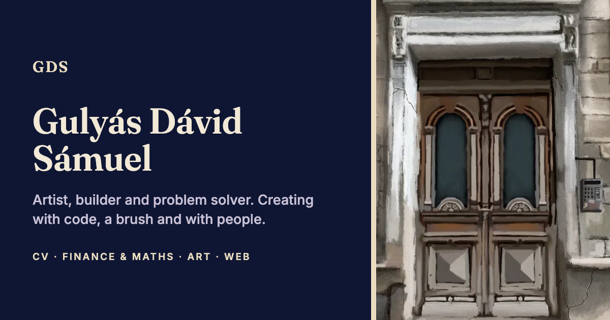

# my-cv-site

My personal CV page: **Gulyás Dávid Sámuel**, artist, builder and problem solver.

- Live (Firebase Hosting): https://cv-gulyas-david.web.app
- Mirror (GitHub Pages): https://g-david-s.github.io/my-cv-site/



Built for Lesson 4 of the Vibe Coding Class (2026 autumn) with a coding agent.
Plain HTML and CSS, plus a little JavaScript for dark mode, scroll animations and the email link.

## Files

| Path | What it is |
| --- | --- |
| `public/index.html` | The page content |
| `public/style.css` | Look: colours, layout, dark mode, phone layout, print/PDF layout |
| `public/script.js` | Dark-mode switch, scroll animations, email link |
| `public/cv-gulyas-david-samuel.pdf` | Downloadable CV (made from the page) |
| `public/assets/` | ArAt picture, Corvinus logo, favicon, link preview image |
| `tools/build.sh` | Rebuilds the PDF and the preview image after a change |
| `firebase.json`, `.firebaserc` | Firebase Hosting settings (publishes `public/`) |
| `.github/workflows/pages.yml` | Publishes `public/` to GitHub Pages on every push |

## Update the site

```sh
sh tools/build.sh                     # only if the content changed: new PDF + preview
git add -A && git commit -m "..." && git push    # GitHub + GitHub Pages
firebase deploy --only hosting --project cv-gulyas-david   # Firebase
```
